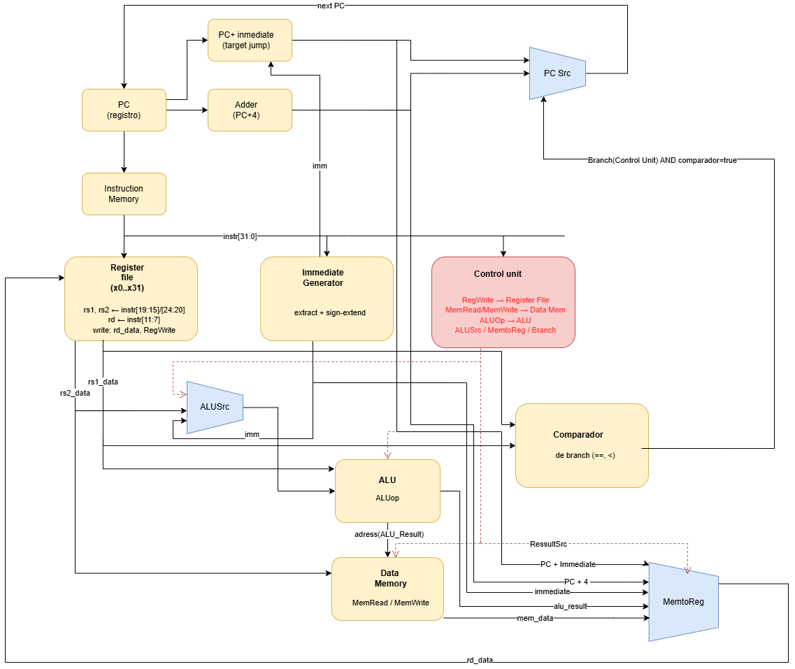

# Single-Cycle RV32I RISC-V Core

A from-scratch, single-cycle implementation of the RV32I base integer instruction set in SystemVerilog. Every module (Register File, ALU, Immediate Generator, Control Unit, Branch Comparator, PC logic, memories, and the top-level datapath) was designed, coded and debugged from a hand-built datapath diagram, then verified module-by-module with directed SystemVerilog testbenches before final integration.

**Status:** functional. All eleven modules pass their individual testbenches, and the fully integrated core correctly executes a hand-assembled test program exercising `addi`, `add`, `sw`, `lw` and a taken `beq` branch, verified against expected register/memory state at the end of simulation.

## Why this project

After completing a UVM verification environment for a 2D convolution accelerator ([UVM_Conv_Accelerator](../UVM_Conv_Accelerator)), this project shifts from verification back to RTL design, with a specific goal: build hands-on familiarity with processor microarchitecture, going from datapath diagram to a working core verified module-by-module. The instruction set, datapath structure, and control signal naming closely follow the classic single-cycle RISC-V design taught in *Digital Design and Computer Architecture: RISC-V Edition* (Harris & Harris), adapted and extended where needed (most notably the write-back path, widened from a simple ALU/memory choice to a five-way source select to correctly support `jal`, `jalr`, `auipc` and `lui`).

## Architecture



The core is a classic five-stage-in-one-cycle datapath (fetch, decode, execute, memory access, write-back), with no pipelining and no hazard logic, since every instruction completes fully within a single clock period. The only stateful elements are the `PC` register and the two memories' internal storage (`Register File`, `Data Memory` write port); everything else is combinational logic sitting between them.

### Module summary

| Module | Role |
|---|---|
| `riscv_pkg.sv` | Shared package: `operation_type` (10-value ALU opcode enum) and `format_type` (5-value immediate-format enum), imported by every module that needs them |
| `PC.sv` | 32-bit program counter register; synchronous, asynchronous reset to 0, loads whatever `PC Src` selects each cycle |
| `ADDER_PC4.sv` | Fixed combinational adder, `PC + 4` (next sequential instruction address) |
| `ADDER_PCIMM.sv` | Combinational adder, `PC + immediate` (branch/`jal` target address) |
| `InstructionMemory.sv` | 256-word ROM indexed by `PC[9:2]` (word-aligned), preloaded via `$readmemh` from a `.mem` file |
| `RegisterFile.sv` | 32 x 32-bit registers, `x0` hardwired to 0 (write-protected, never targeted by the write port), two combinational read ports, one synchronous write port |
| `Immediate_Gen.sv` | Extracts and sign-extends the immediate for I/S/B/U/J formats, selecting the reconstruction pattern via `Format` |
| `Control_Unit.sv` | Decodes `opcode`/`funct3`/`funct7[5]` into every control signal used downstream (`RegWrite`, `ALUSrc`, `MemRead`, `MemWrite`, `Branch`, `Jump`, `ResultSrc`, `ALUControl`, `Format`) |
| `ALU.sv` | 10-operation arithmetic/logic unit (`ADD`, `SUB`, `AND`, `OR`, `XOR`, `SLL`, `SRL`, `SRA`, `SLT`, `SLTU`), reused for both real computation and address calculation (`lw`/`sw`/`jalr`) |
| `Branch_Comparator.sv` | Evaluates all six branch conditions (`beq`, `bne`, `blt`, `bge`, `bltu`, `bgeu`) directly from `funct3`, comparing `rs1_data`/`rs2_data` with or without sign as needed |
| `DataMemory.sv` | 256-word RAM for `lw`/`sw`, indexed by the ALU-computed address; combinational read, synchronous write gated by `MemWrite` |
| `PC_Src.sv` | Resolves the next `PC` value: `PC+4` by default, `PC+immediate` on a taken branch or `jal`, or the ALU result on `jalr` (distinguished by reusing `ALUSrc`, since only `jalr` routes an address through the ALU) |
| `top.sv` | Top-level module; instantiates and wires all of the above, plus the `ALUSrc` mux and the five-way write-back mux (`ResultSrc`-controlled), both written inline rather than as separate modules |

### The write-back path: `ResultSrc`

The single most significant deviation from a minimal add/load/store-only design is the write-back mux, widened from a 1-bit `MemtoReg` (ALU vs. memory) to a 3-bit `ResultSrc` with five sources, needed to correctly support the instructions that don't fit the simple "ALU result or memory data" pattern:

| `ResultSrc` | Source | Used by |
|---|---|---|
| `000` | ALU result | R-type, I-type arithmetic |
| `001` | Data Memory read data | `lw` |
| `010` | `PC + 4` | `jal`, `jalr` (return address) |
| `011` | `PC + immediate` | `auipc` |
| `100` | Immediate, unmodified | `lui` |

## Instruction set coverage

All of RV32I base integer is implemented, with two deliberate scope cuts:

- **Loads/stores:** only full-word `lw`/`sw`. Byte/half-word variants (`lb`, `lh`, `lbu`, `lhu`, `sb`, `sh`) are not implemented; the memories only support word-aligned, word-wide access.
- **System instructions:** `fence`, `ecall`, `ebreak` are not implemented, since there is no OS, no memory-ordering concern (single in-order core, no pipeline), and no trap handling in this design.

Everything else — all R-type ALU ops, all I-type arithmetic ops (including shifts), `lw`, `sw`, all six branches, `jal`, `jalr`, `lui`, `auipc` — is implemented and, for the subset exercised by the test program below, verified.

## Verification results

Each module was verified in isolation with a directed, self-checking SystemVerilog testbench before integration:

| Module | Testbench | Result |
|---|---|---|
| `RegisterFile` | `tb_RegisterFile.sv` | 8/8 checks PASS |
| `ALU` | `tb_ALU.sv` | 11/11 checks PASS (including negative subtraction, arithmetic shift sign-extension, signed vs. unsigned comparison) |
| `Immediate_Gen` | `tb_Immediate_Gen.sv` | 9/9 checks PASS (positive/negative cases for I/S/B/J, one case for U) |
| `Control_Unit` | `tb_Control_Unit.sv` | 12/12 checks PASS (one representative instruction per opcode branch, plus the two `funct7`-disambiguated cases `sub`/`srai`) |
| `top` (full integration) | `tb_top.sv` | 6/6 checks PASS: `addi`, `addi`, `add`, `sw`, `lw`, and a taken `beq` verified against expected final register/memory state |

`PC`, the two adders, `InstructionMemory`, `DataMemory`, `Branch_Comparator` and `PC_Src` were reviewed manually rather than given their own dedicated testbenches (see "Known limitations" below); their correctness is covered indirectly through the full-integration test.

### The integration test program

A short hand-assembled program, loaded into `InstructionMemory` via `instructions.mem`, deliberately exercises arithmetic, memory, and control flow together, ending in a self-branch (`beq x0, x0, 0`) used as a halt:

```
addi x1, x0, 5      # x1 = 5
addi x2, x0, 10     # x2 = 10
add  x3, x1, x2     # x3 = 15
sw   x3, 0(x0)      # mem[0] = 15
lw   x4, 0(x0)      # x4 = 15, read back from memory
beq  x3, x4, 8      # x3 == x4, taken: skips the next instruction
addi x5, x0, 99     # must NOT execute if the branch works correctly
beq  x0, x0, 0      # infinite self-loop (halt)
```

Expected end state: `x1=5, x2=10, x3=15, x4=15, x5=0, mem[0]=15`. `x5` staying at its reset value of `0` is the key assertion: it is the only way to confirm the branch was actually taken, rather than the program simply not having reached that instruction yet.

The final testbench (`tb_top.sv`) checks this end state via hierarchical signal references (`dut.RF.registers[N]`, `dut.DM.memory[0]`) rather than dedicated debug ports, since the core's only real external interface is `clk` and `rst`.

## Repository structure

```
rtl/            All design modules listed in "Module summary" above, plus riscv_pkg.sv
tb/             tb_RegisterFile.sv, tb_ALU.sv, tb_Immediate_Gen.sv, tb_Control_Unit.sv, tb_top.sv
Procesador.drawio.png   Full datapath diagram (source of truth for the architecture)
instructions.mem        Hex machine code for the integration test program
```

## Reproducing the results (Vivado)

1. Add every file under `rtl/` (including `riscv_pkg.sv`) as Design Sources, in the same fileset, so Vivado resolves the package `import` correctly, and let it recalculate the compile order (`update_compile_order -fileset sources_1`) so `riscv_pkg.sv` compiles before anything that imports it.
2. Add the `tb/` files as Simulation Sources.
3. Place `instructions.mem` where the `$readmemh` call in `InstructionMemory.sv` expects to find it (Vivado auto-detects and copies memory-initialization files referenced this way into the simulation run directory).
4. Set `tb_top` as the simulation top module for the full integration run (or any of the other `tb_*` modules to re-run an individual module's test in isolation).
5. Launch simulation.

## Known limitations / future work

1. **No dedicated testbenches for six modules** (`PC`, `ADDER_PC4`, `ADDER_PCIMM`, `InstructionMemory`, `DataMemory`, `Branch_Comparator`, `PC_Src`). They are simple enough that their correctness is effectively covered by the full-integration test passing, but isolated verification would be more rigorous and easier to debug if a future change breaks one of them.
2. **Fixed 256-word memories.** Both `InstructionMemory` and `DataMemory` are hardcoded to 256 words (1KB) rather than parameterized, limiting program and data size.
3. **No byte/half-word memory access.** Only `lw`/`sw`; a real program relying on `lb`/`lh`/`sb`/`sh` (e.g. for string or byte-array handling) would not run correctly.
4. **Single test program.** Verification coverage is one hand-written program exercising a subset of instructions (`addi`, `add`, `sw`, `lw`, `beq`); `jal`, `jalr`, `lui`, `auipc`, and the remaining ALU/branch operations are exercised individually at the module level (`tb_ALU`, `tb_Branch_Comparator` design, `tb_Control_Unit`) but not yet in an end-to-end integration scenario.
5. **Single-cycle only.** No pipelining, so clock frequency is bounded by the slowest instruction's combinational path (`lw`, register read through ALU through memory through write-back mux). This is a deliberate simplification for a first RISC-V implementation, not a final design goal.
